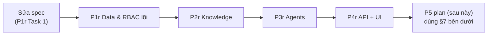

# Áp dụng bài học DataAgent vào AI Business Assistant v2 — Phân tích ảnh hưởng & Thứ tự sửa đổi

> Tài liệu này là **spec bổ sung** (addendum) cho `docs/AI_Business_Assistant_v2_Architecture_Detail.md`. Bốn plan sửa đổi `P1r → P2r → P3r → P4r` đều lập luận từ tài liệu này. Tài liệu cũng nêu trước các thay đổi spec cho **P5 (Worker)**, vì P5 chưa có plan.

## 1. Mục tiêu và phạm vi

Đưa 6 tính năng học từ DataAgent vào hệ thống Tài chính & Kho của Gỗ Minh Long:

| ID | Tính năng | Người dùng thấy gì |
| --- | --- | --- |
| F1 | **Tổng quan theo vai trò** | Banner chào buổi sáng gồm số cảnh báo mở, số hành động mở, ngày chốt dữ liệu; thẻ KPI riêng cho từng vai trò |
| F2 | **KPI có sparkline & delta** | Mỗi thẻ KPI có giá trị, % thay đổi so với kỳ trước và biểu đồ mini 12 kỳ |
| F3 | **Cảnh báo dạng Master–Detail có bằng chứng** | Danh sách lọc theo lĩnh vực/mức độ/trạng thái; ô chi tiết có chuỗi số liệu bằng chứng, ngưỡng, hành động đã duyệt, nút "Hỏi tiếp Agent" |
| F4 | **Chat giàu thông tin + gợi ý câu hỏi** | Số liệu hiện dạng thẻ; xu hướng/gợi ý hành động mở sẵn; câu hỏi gợi ý theo vai trò |
| F5 | **Hành động (action item)** | Biến một hành động đã duyệt (từ cảnh báo hoặc câu trả lời chat) thành việc cần làm, giao cho `authority_role`, theo dõi trạng thái |
| F6 | **Ghim KPI** | Người dùng ghim KPI lên trang Tổng quan |

**Phi mục tiêu (không làm trong đợt này):**
- Luồng nộp và chuẩn hoá Excel của DataAgent: GML đã có Data Warehouse tập trung.
- **"Tác động ước tính" (−62 tr/tháng) do LLM tính**: vi phạm Nguyên tắc 1 (không dùng LLM tính số) và M-08. Chỉ hiện tác động khi `kpi_definitions.yaml` có công thức tất định. Đợt này chưa có KPI nào có công thức như vậy.
- Biểu đồ phân rã (theo ngân hàng/SKU) trong bằng chứng cảnh báo: cần thêm golden query phân rã. Để lại đợt sau.
- Ghim một câu trả lời chat bất kỳ: sẽ lưu số liệu cũ và hết hạn theo TTL của `app.chat_turn`. Chỉ cho ghim **KPI** (tính lại trực tiếp, RBAC được kiểm tra mỗi lần xem).

## 2. Những điểm gốc phát hiện khi khảo sát code

Đây là các điểm khiến tính năng mới **không thể chỉ vá ở P4**:

| # | Phát hiện | Bằng chứng | Hệ quả nếu chỉ sửa ở P4 |
| --- | --- | --- | --- |
| R1 | Chuỗi thời gian của KPI được viết cứng trong T3 (17 nhánh `if`, 14 trong số đó là KPI chuẩn). KPI không có SQL thì **trả chuỗi giả** `'2026-07', 0.0` | `v2/app/agents/trend_agent.py:154-380` (fallback ở dòng 373-378) | Sparkline của KPI chưa hỗ trợ sẽ hiện số 0 giả. API phải sao chép SQL chuỗi lần thứ hai |
| R2 | Không có thành phần nào **ghi** `app.alert_event`, trừ script chụp màn hình seed tay | `v2/scripts/capture_ui_screenshots.py:65-70`. Không router/agent nào `INSERT` | Bằng chứng cảnh báo không có nguồn. P5 sẽ phải sửa lại bảng lần nữa |
| R3 | `apply_db.py` chỉ chạy đúng file `001_init_app_schema.sql` | `v2/db/apply_db.py:250-251` | Migration mới sẽ không được áp dụng |
| R4 | Kiểm tra quyền theo KPI là hàm private trong router cảnh báo | `v2/app/api/routers/alerts.py:29-37` (`_user_can_access_kpi`) | Actions/Pins/Overview sẽ chép lại logic RBAC này 3 lần |
| R5 | Logic tính KPI (golden query + cache + audit) nằm trong thân router | `v2/app/api/routers/kpi.py:35-160` | Overview phải gọi HTTP nội bộ hoặc chép logic |
| R6 | Khoá cache KPI cố định 4 thành phần, không phân biệt giá trị với chuỗi | `v2/app/core/cache.py:32` | Chuỗi và giá trị có thể ghi đè nhau trong cache |
| R7 | `ChatResponse` không trả `kpi_keys` | `v2/app/api/schemas.py:37-45` | UI không biết câu trả lời ứng với KPI nào để ghim |
| R8 | `KPI_DISPLAY_NAMES` trong UI có `doanh_thu_thuan`, `bien_loi_nhuan_gop`, nhưng hai KPI này **không có** trong `kpi_definitions.yaml` (28 KPI) | `v2/app/ui/streamlit_app.py:39-46` | Thẻ KPI tổng quan sẽ gọi `/v1/kpi` và nhận 404. Danh sách KPI phải lấy từ T2, không viết cứng trong UI |
| R9 | `vong_quay_hang_ton_kho` cần cả `ai_v_ton_kho` và `ai_v_bctc`, mà `quan_ly_kho` chỉ được xem `ai_v_ton_kho` | `kpi_definitions.yaml` (nguon_view), `db/catalog.yaml` (allowed_roles) | Đưa KPI này vào tổng quan của Quản lý kho sẽ luôn trả 403. Đây là lý do cần TC-T2-08 |

## 3. Quyết định thiết kế

| ID | Quyết định | Lý do |
| --- | --- | --- |
| D1 | Chuyển SQL chuỗi thời gian từ T3 sang **T2 Knowledge** (`golden_queries/series/` + `series_index.yaml`, trường `series_ref` trong KPI) | Sửa R1 tận gốc: Trend (T3), KPI API (T5) và Alert engine (T7) dùng chung một nguồn. Lint đảm bảo phủ đủ và đúng view |
| D2 | KPI chưa có `series_ref` → **không có chuỗi**, báo trung thực, bỏ fallback giả | Đúng tinh thần C1/TC-T3-10 |
| D3 | Sửa `app.alert_event` **một lần** cho cả P4 và P5: thêm `period`, `evidence JSONB`, `dedup_key` (unique), `escalated_at` | Tránh phải sửa bảng lần hai khi làm P5 (TC-T7-03 idempotent, TC-T7-05 leo thang) |
| D4 | Bảng mới `app.action_item` và `app.pinned_kpi` trong migration `002`. `apply_db` chạy **mọi** file migration theo thứ tự tên | Sửa R3 |
| D5 | `can_access_kpi(role, kpi_key)` và `kpi_domain(kpi_key)` chuyển vào `app/core/security.py` | Sửa R4: RBAC nằm một chỗ |
| D6 | `domain` của cảnh báo/KPI suy ra từ `dashboard` (D1…D5), **không** lưu cột | Không trùng dữ liệu. Ánh xạ theo tiêu đề trong `kpi_definitions.yaml`: D1→`no_vay` (Tài chính – nợ vay), D2→`kho`, D3→`cong_no`, D4→`tien_gui` (Tiền gửi & Thanh khoản), D5→`dong_tien`. Lint xác nhận mọi giá trị `dashboard` đều có ánh xạ. *Lưu ý: `DASHBOARD_LABELS` trong `streamlit_app.py` (ban_hang/mua_hang/san_xuat) **không khớp** với `kpi_definitions.yaml`; P4r sửa lại cho khớp* |
| D7 | Hành động chỉ nhận **văn bản đã duyệt** trong `business_rules.yaml` (so khớp chuẩn hoá giống `filter_approved_actions`). `assigned_role = authority_role` của quy tắc | Giữ TC-T3-11. Không sửa YAML quy tắc, không cần ID mới |
| D8 | Tách `app/services/kpi_service.py` (tính giá trị + chuỗi + cache) và `app/services/briefing.py` (`build_briefing`). Router chỉ gọi service | Sửa R5. P5 `weekly_brief.py` dùng lại `build_briefing` |
| D9 | Khoá cache chuỗi giữ nguyên dạng 4 thành phần, thành phần KPI là `f"{kpi_key}#series"` (`#` bị lint cấm trong tên KPI) | Sửa R6 mà không đổi kiểu của `make_kpi_key` (Review Focus #2 của P4 giữ nguyên) |
| D10 | Hồ sơ vai trò (`role_profiles.yaml`: KPI tổng quan, câu hỏi gợi ý) thuộc T2. Lint chặn KPI vượt quyền và câu hỏi rò rỉ sang tập `split: test` | Gợi ý câu hỏi nằm trong UI nhưng có thể làm hỏng TC-T2-03 (chống rò rỉ) |

## 4. Ma trận ảnh hưởng: tính năng × phase

| | P1 Data (T1 + core) | P2 Knowledge (T2) | P3 Agents (T3) | P4 API + UI (T5/T6) | P5 Worker (T7, chưa làm) |
| --- | --- | --- | --- | --- | --- |
| F1 Tổng quan | — | `role_profiles.yaml` | — | `briefing.py`, `GET /v1/overview`, `overview_view.py` | `weekly_brief` dùng lại `build_briefing`; heartbeat `alert_engine` cho biết dữ liệu mới đến đâu |
| F2 Sparkline | — | `series_ref`, SQL chuỗi | `load_kpi_series`, `summarize_series` | `?include=series` | — |
| F3 Bằng chứng cảnh báo | cột `alert_event` | — | `build_alert_evidence` | trường mở rộng của `AlertItem` + bộ lọc; master–detail | engine ghi `evidence`/`dedup_key`/`period` |
| F4 Chat giàu thông tin | — | câu hỏi gợi ý | — | `ChatResponse.kpi_keys`, `chat_view.py` | — |
| F5 Hành động | `app.action_item`, `can_access_kpi` | — | `resolve_approved_action` | `/v1/actions`, `actions_view.py` | (tuỳ chọn) leo thang tạo action |
| F6 Ghim | `app.pinned_kpi` | — | — | `/v1/pins` | — |

## 5. Thứ tự sửa đổi & cổng kiểm thử

**Luật thực thi:**
1. Mỗi phase sửa đổi là **một plan riêng, một chuỗi commit riêng** (`feat(v2-p1r): …`, …).
2. Chỉ sang phase sau khi phase trước **xanh toàn bộ**: bộ test hiện có (**137** test đếm ngày 2026-11-15) và test mới của phase đó.
3. Phase sau **không được** sửa ngược file của phase trước. Nếu thiếu gì, dừng lại, bổ sung vào plan của phase trước rồi chạy lại cổng của phase đó. Đây chính là cơ chế chống sửa đi sửa lại.
4. Bằng chứng (EV) bị ảnh hưởng phải được tạo lại trong chính phase làm thay đổi nó: EV-04 ở P2r, EV-09 ở P3r, EV-13/14/16 ở P4r.

| Plan | File |
| --- | --- |
| P1r | `docs/plans/2026-11-15-v2-p1r-data-and-rbac-revision-plan.md` |
| P2r | `docs/plans/2026-11-15-v2-p2r-knowledge-revision-plan.md` |
| P3r | `docs/plans/2026-11-15-v2-p3r-agents-revision-plan.md` |
| P4r | `docs/plans/2026-11-15-v2-p4r-api-and-ui-revision-plan.md` |

## 6. Sửa đổi spec `AI_Business_Assistant_v2_Architecture_Detail.md`

Áp dụng ở **P1r Task 1**, trước mọi thay đổi code:

- **§4 Bản đồ tầng, dòng T6**: `Streamlit (Tổng quan · Cảnh báo · Hỏi đáp · Hành động · Lịch sử) · nút "Hỏi AI" từ Power BI`.
- **§5 T1 bảng file `db/migrations/`**: thêm `002_dataagent_adoption.sql`: `app.action_item`, `app.pinned_kpi`, cột `alert_event.{period, evidence, dedup_key, escalated_at}`.
  - TC-T1-08: migration 002 áp dụng được 2 lần không lỗi; các cột/bảng tồn tại.
  - TC-T1-09: `gml_ai_ro` không ghi được `app.action_item`/`app.pinned_kpi`.
- **§5 T2**: thêm file `golden_queries/series/*.sql` + `series_index.yaml` và `role_profiles.yaml`. Hợp đồng thêm `get_series_query(kpi_key) -> SeriesQuery | None` và `get_role_profile(role) -> RoleProfile`.
  - TC-T2-08: mọi `overview_kpis` của vai trò đều truy cập được bằng chính vai trò đó.
  - TC-T2-09: câu hỏi gợi ý không rò rỉ sang benchmark `split: test` (cosine < 0,92).
  - TC-T2-10: mọi SQL chuỗi chỉ dùng view trong `views_used` và qua được validator.
  - Phép đo M-05b: độ phủ chuỗi = số KPI tổng quan có `series_ref` / tổng số KPI tổng quan (mục tiêu 100%).
- **§5 T3 bảng agent**: Trend đọc chuỗi từ T2. Thêm hàm thuần `summarize_series`, `build_alert_evidence`, `resolve_approved_action`.
  - TC-T3-14: KPI không có `series_ref` → `trend=None` kèm lỗi "chưa có truy vấn chuỗi thời gian", không có chuỗi giả.
  - TC-T3-15: bằng chứng cảnh báo chỉ chứa số có trong chuỗi đầu vào.
- **§5 T5 danh sách file**: thêm `routers/{overview,actions,pins}.py` và `app/services/`.
  - TC-T5-10: quản lý kho ghim/tạo hành động trên KPI tài chính → 403 và có audit.
  - TC-T5-11: tạo hành động từ `request_id` của người khác → 404.
  - TC-T5-12: một KPI tổng quan lỗi → `/v1/overview` vẫn 200, thẻ đó có `error`.
- **§5 T6**: 5 màn hình.
  - TC-T6-06: mặc định mở Tổng quan, nhưng URL Quick Ask có `kpi`/`dashboard` thì mở Chat.
  - TC-T6-07: nút "Tạo hành động" gọi `POST /v1/actions`.
  - EV-16 thêm ảnh `05_overview.png`, `06_alert_detail.png`, `07_actions.png`.
- **§5 T7**: xem §7.

## 7. Spec đặt trước cho P5 (Worker) — để P5 không phải sửa ngược P1–P4

- `engine.py` ghi `app.alert_event` với `period` (`YYYY-MM`), `dedup_key = f"{rule_id}:{kpi_key}:{period}"` dùng `INSERT … ON CONFLICT (dedup_key) DO NOTHING` (đáp ứng TC-T7-03), và `evidence = build_alert_evidence(...).model_dump()`.
- Leo thang (TC-T7-05) đặt `escalated_at`. Không tạo cảnh báo mới.
- Heartbeat ghi `app.job_heartbeat(job_name='alert_engine', status='ok'|'error')`. `build_briefing` đọc dòng `ok` mới nhất làm `last_alert_job_at`.
- `weekly_brief.py` gọi `build_briefing(role='ceo', …)` (không dựng KPI lần hai). TC-T7-08 giữ nguyên.
- TC-T7-10 (mới): mọi cảnh báo do engine tạo đều có `evidence.series` khác rỗng **hoặc** `evidence.coverage_warning`. Mọi số trong `evidence` đều thuộc chuỗi đầu vào.

## 8. Rủi ro còn lại

| Rủi ro | Cách giảm |
| --- | --- |
| Đổi màn mặc định sang Tổng quan làm vỡ TC-T6-01..04 | P4r Task 6 cập nhật `AppTest` để chọn màn tường minh. TC-T6-06 khoá hành vi Quick Ask |
| OpenAPI snapshot (TC-T5-08) đổi | Tạo lại EV-13 ở P4r Task 7 và kiểm tra diff chỉ là phần thêm mới |
| Trên Real nhiều KPI chỉ có 1 tháng dữ liệu (C1) | `summarize_series` trả `delta_pct=None` khi < 2 điểm. UI hiện "Chưa đủ dữ liệu xu hướng" |
| Trước khi có P5, `alert_event` vẫn chỉ có dữ liệu seed | Script seed (P4r Task 7) ghi `evidence` bằng `build_alert_evidence` để màn chi tiết có dữ liệu thật từ chuỗi |
